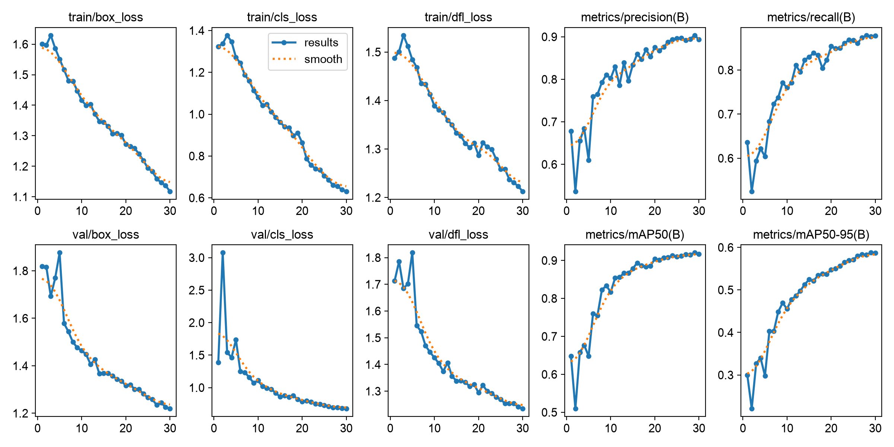
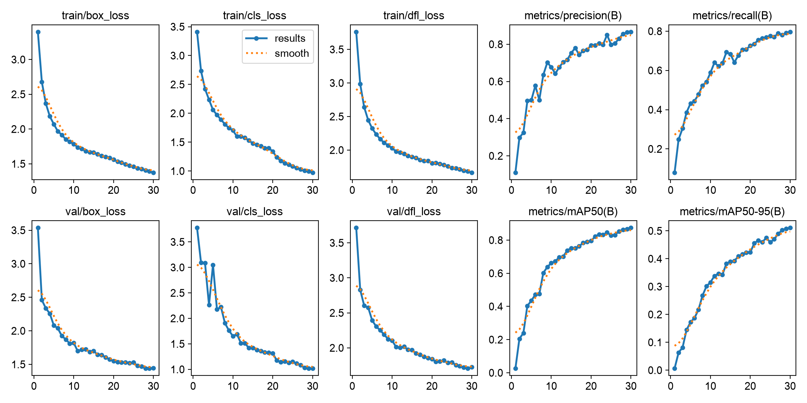
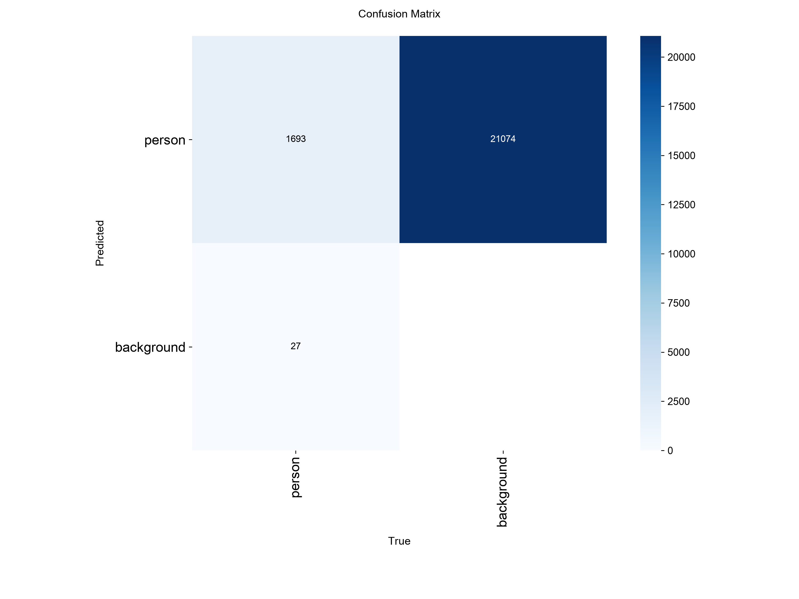
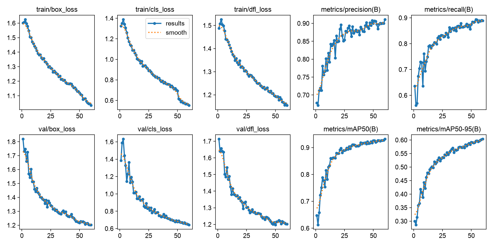

# RE-503-PJ1: Perbandingan Transfer Learning dan Tuning pada YOLOv8n

| | |
|---|---|
| **Nama** | Elyas Wisnu Perdana |
| **NIM** | 4222411037 |
| **Tugas** | Praktik terpadu: melatih, tuning, memilih, dan menguji model YOLO |
| **Perangkat** | NVIDIA GeForce RTX 3050 6GB Laptop GPU |

## 1. Ringkasan

Tiga eksperimen dijalankan pada dataset deteksi orang (1 kelas, `person`) dengan model YOLOv8n. Semua pengaturan sama (seed 42, `imgsz` 640, batch 16, 30 epoch) kecuali yang sengaja diubah:

- **E1**: bobot pretrained COCO (transfer learning), sebagai baseline.
- **E2**: arsitektur sama, bobot acak (tanpa transfer learning), sebagai pembanding.
- **E3**: E1 dengan satu perubahan, yaitu `epochs=60`.

Model terbaik dipilih dari mAP50-95 pada data **val**, lalu diuji **sekali** pada data **test**.

| Eksperimen | mAP50-95 (val) | Catatan |
|---|---|---|
| E1 pretrained | 0.5876 | baseline |
| E2 scratch | 0.5109 | lebih rendah 0.0767 dari E1 |
| **E3 pretrained, 60 epoch** | **0.6034** | **terbaik, lalu diuji pada test: mAP50-95 0.6012** |

## 2. Dataset dan persiapan (Tahap 1-2)

**Sumber:** dataset `SANINDO` (v1) dari Roboflow, diekspor dalam format COCO, lalu diubah ke format YOLO dengan `03_coco_ke_yolo.py`. Karena memakai dataset sendiri, program `00_ambil_subset_coco.py` tidak dijalankan.

| Split | Gambar | Kotak (bounding box) |
|---|---|---|
| train | 2265 | 6409 |
| val | 647 | 1720 |
| test | 323 | 903 |
| **Total** | **3235** | **9032** |

- **Kelas:** 1 kelas (`person`).
- **Pembagian data:** pembagian asli Roboflow dipertahankan oleh `05_split_dataset_yolo.py`, bukan diacak ulang. Dataset Roboflow dapat memuat salinan hasil augmentasi dari foto yang sama, sehingga pengacakan ulang berisiko memasukkan foto yang sama ke train dan test sekaligus (kebocoran data).
- **Cek anotasi (`01_cek_anotasi.py`):** tidak ada file label yang hilang atau berformat salah. Ada 33 peringatan "kotak sangat kecil" (sisi kurang dari 10 piksel, umumnya kotak sempit dan tinggi seperti 10x33 px). Ini peringatan, bukan kesalahan format.
- **Bukti visual:** `cek_visual/cek_visual_1.jpg`, `cek_visual_2.jpg`, `cek_visual_3.jpg` (kotak anotasi tepat menempel pada objek).
- **Log program:** `log/log_03.txt`, `log/log_01.txt`, `log/log_05.txt`. Berkas `data.yaml` ada di folder utama.

## 3. Pengaturan eksperimen (Tahap 3)

| Parameter | E1 | E2 | E3 |
|---|---|---|---|
| Model | yolov8n | yolov8n | yolov8n |
| Bobot awal | pretrained COCO (`yolov8n.pt`) | acak (`yolov8n.yaml`) | pretrained COCO |
| Epoch | 30 | 30 | **60** (satu-satunya perubahan) |
| imgsz / batch / seed | 640 / 16 / 42 | 640 / 16 / 42 | 640 / 16 / 42 |

Perintah yang dijalankan:

```bash
python 06_latih_bandingkan.py --nim 4222411037 --nama "Elyas Wisnu Perdana" --epochs 30 --ubah epochs=60
```

## 4. Hasil

### 4.1 Data validasi (nilai pada epoch terbaik)

| Eksperimen | Epoch terbaik | Precision | Recall | mAP50 | mAP50-95 | Durasi (menit) |
|---|---|---|---|---|---|---|
| E1 pretrained | 29 | 0.9034 | 0.8757 | 0.9205 | 0.5876 | 14.6 |
| E2 scratch | 30 | 0.8665 | 0.7965 | 0.8740 | 0.5109 | 13.4 |
| **E3 pretrained + 60 epoch** | 60 | **0.9109** | **0.8890** | **0.9316** | **0.6034** | 28.8 |

### 4.2 Hasil test (model terbaik: E3, diuji sekali)

| Model | Precision | Recall | mAP50 | mAP50-95 |
|---|---|---|---|---|
| E3 pada **test** | 0.9066 | 0.9014 | 0.9390 | 0.6012 |
| E3 pada val (pembanding) | 0.9109 | 0.8890 | 0.9316 | 0.6034 |

Confusion matrix test: `uji_test/confusion_matrix.png`.

### 4.3 Kurva pelatihan dan confusion matrix (val)

| | Kurva (`results.png`) | Confusion matrix |
|---|---|---|
| E1 |  |  |
| E2 |  |  |
| E3 |  |  |

Hasil dari confusion matrix pada data val (1720 objek sebenarnya):

| | Terdeteksi benar (TP) | Terlewat (FN) | Salah deteksi pada latar (FP) |
|---|---|---|---|
| E1 | 1701 (98,9%) | 19 | 10084 |
| E2 | 1693 (98,4%) | 27 | 21074 |
| E3 | 1698 (98,7%) | 22 | 6977 |

Catatan membaca tabel ini: nilai FP besar karena Ultralytics menghitung confusion matrix saat validasi dengan ambang kepercayaan sangat rendah (0,001) agar kurva mAP lengkap. Jadi angka FP tidak menggambarkan jumlah alarm palsu saat model dipakai dengan ambang normal. Angka ini hanya layak dibandingkan antareksperimen.

## 5. Analisis

### 5.1 Efek transfer learning (E1 dibandingkan E2)

Dengan pengaturan yang sama dan 30 epoch, model yang memakai bobot pretrained COCO lebih baik pada semua metrik. mAP50-95 E1 adalah 0.5876 sedangkan E2 hanya 0.5109 (selisih 0.0767, sekitar 13% lebih rendah). Recall E2 juga turun 0.0792 dan precision turun 0.0369.

Perbedaan paling jelas terlihat di awal pelatihan. Pada epoch 1, E1 sudah mencapai mAP50 0.648, sementara E2 baru 0.026 karena mulai dari bobot acak. E1 mencapai mAP50-95 di atas 0.5 pada epoch 14, sedangkan E2 baru pada epoch 28. Bobot pretrained COCO sudah mengenali fitur dasar (tepi, tekstur, bentuk tubuh), dan COCO memuat kelas `person`, jadi model hanya perlu menyesuaikan diri ke dataset ini.

Namun E2 belum berhenti belajar. Epoch terbaiknya adalah epoch terakhir (30), dan mAP50-95 masih naik 0.088 dalam 10 epoch terakhir (E1 hanya naik 0.039). Jadi selisih 0.0767 adalah selisih pada anggaran 30 epoch, bukan batas akhir. Dengan pelatihan lebih panjang, E2 kemungkinan mengecil jaraknya, meski tidak ada eksperimen yang membuktikannya di sini. Waktu pelatihan keduanya hampir sama (14.6 dan 13.4 menit), jadi keuntungan transfer learning ada pada kecepatan konvergensi dan kualitas hasil, bukan biaya per epoch.

### 5.2 Efek perubahan satu variabel: epoch 30 menjadi 60 (E1 dibandingkan E3)

E3 mengubah satu hal saja dari E1, yaitu jumlah epoch, sehingga perbedaannya bisa dikaitkan dengan lama pelatihan. Hasilnya naik, tetapi kecil: mAP50-95 dari 0.5876 menjadi 0.6034 (+0.0158, sekitar +2,7%), mAP50 dari 0.9205 menjadi 0.9316 (+0.0111), recall +0.0133, dan precision +0.0075.

Biayanya hampir dua kali lipat: 28.8 menit dibanding 14.6 menit. Peningkatannya juga menunjukkan hasil yang makin kecil. Dalam 10 epoch terakhir E3 hanya menambah mAP50-95 sebesar 0.0117, dan kurvanya sudah mendatar. Pada epoch 30, E3 (0.5459) bahkan masih di bawah E1 pada epoch 30 (0.5871). Penyebab yang masuk akal adalah jadwal learning rate dan penutupan augmentasi mosaic (default 10 epoch terakhir) pada E3 diregangkan ke 60 epoch, sehingga manfaat fase akhir baru terlihat belakangan. Kurva `train/cls_loss` memperlihatkan penurunan tajam di sekitar epoch 20 pada E1 dan epoch 50 pada E3, sesuai dugaan ini.

Tidak ada tanda overfitting: loss validasi pada E3 terus turun hingga epoch 60 dan tetap dekat dengan loss pelatihan (box loss 1.202 pada val dibanding 1.034 pada train).

### 5.3 Confusion matrix

Karena hanya ada satu kelas, tidak ada kebingungan antarkelas. Kesalahan hanya berupa objek yang terlewat (FN) atau deteksi pada latar (FP). Ketiga model mendeteksi hampir semua orang (98,4% sampai 98,9%), sehingga perbedaan utama ada pada FP: E3 paling sedikit (6977), E1 (10084), dan E2 paling banyak (21074, sekitar dua kali E1). Urutan ini konsisten dengan urutan precision (E3 0.9109, E1 0.9034, E2 0.8665). Selisih FN antarmodel kecil (19, 22, dan 27 objek), sehingga tidak banyak yang bisa disimpulkan dari angka itu saja.

### 5.4 Hasil pada data test

E3 dipilih karena mAP50-95 val tertinggi, lalu diuji sekali pada data test dan menghasilkan mAP50-95 0.6012, nyaris sama dengan nilai val (0.6034), dan mAP50 0.9390 (val 0.9316). Kedekatan ini menunjukkan model tidak terlalu menyesuaikan diri ke data val dan hasilnya dapat digeneralisasi ke data yang belum pernah dilihat. Data test hanya 323 gambar (903 objek), jadi selisih kecil seperti ini wajar dan tidak perlu dibaca berlebihan. Karena pengujian hanya dilakukan untuk model terbaik, E1 dan E2 tidak dibandingkan pada data test.

### 5.5 Keterbatasan

- Setiap eksperimen dijalankan satu kali dengan satu seed. Selisih E1 dan E3 (0.0158) cukup kecil sehingga mungkin berada dalam kisaran variasi antar-seed, tidak seperti selisih E1 dan E2 yang jauh lebih besar. Kesimpulan tentang E3 sebaiknya dianggap indikatif.
- mAP50 tinggi (sekitar 0.93) tetapi mAP50-95 hanya sekitar 0.60, artinya model menemukan orangnya dengan baik, tetapi ketepatan posisi kotak pada IoU yang ketat masih lebih lemah. Salah satu kemungkinan penyebabnya adalah adanya kotak yang sangat kecil dan sempit (33 peringatan pada cek anotasi). Dugaan ini belum diuji.
- Hanya satu ukuran model (YOLOv8n) dan satu jenis perubahan (epoch) yang dicoba. Tuning hyperparameter lain (learning rate, ukuran gambar) tidak dibandingkan.

## 6. Kesimpulan

1. **Transfer learning sangat membantu.** Dibanding bobot acak, E1 lebih unggul di semua metrik (mAP50-95 0.5876 dibanding 0.5109) dan konvergen jauh lebih cepat dengan waktu per epoch yang sama.
2. **Menambah epoch dari 30 ke 60 memberi peningkatan kecil tetapi nyata di data ini** (mAP50-95 0.5876 menjadi 0.6034), dengan biaya waktu sekitar dua kali lipat dan hasil yang mulai melandai.
3. **Model terbaik adalah E3**, yang pada data test menghasilkan mAP50 0.9390 dan mAP50-95 0.6012, konsisten dengan hasil validasi.

## 7. Struktur repositori

```
RE-503-PJ1/
├── E1/ E2/ E3/                  # results.csv, results.png, confusion_matrix.png
├── uji_test/                    # confusion_matrix.png (hasil test)
├── cek_visual/                  # 3 gambar bukti anotasi
├── log/                         # log_01.txt, log_03.txt, log_05.txt
├── program_praktik_terpadu/     # 01-06 *.py
├── data.yaml
├── hasil_praktik_4222411037.csv
├── hasil_praktik_4222411037.txt
└── README.md
```

Dataset: `[isi tautan Google Drive atau keterangan dataset_v1.zip bila diunggah]`.

Cara mengulang:

```bash
python 03_coco_ke_yolo.py SANINDO dataset_yolo
python 01_cek_anotasi.py dataset_yolo
python 05_split_dataset_yolo.py dataset_yolo
python 06_latih_bandingkan.py --nim 4222411037 --nama "Elyas Wisnu Perdana" --epochs 30 --ubah epochs=60
```
